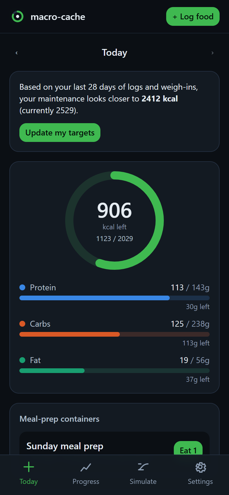
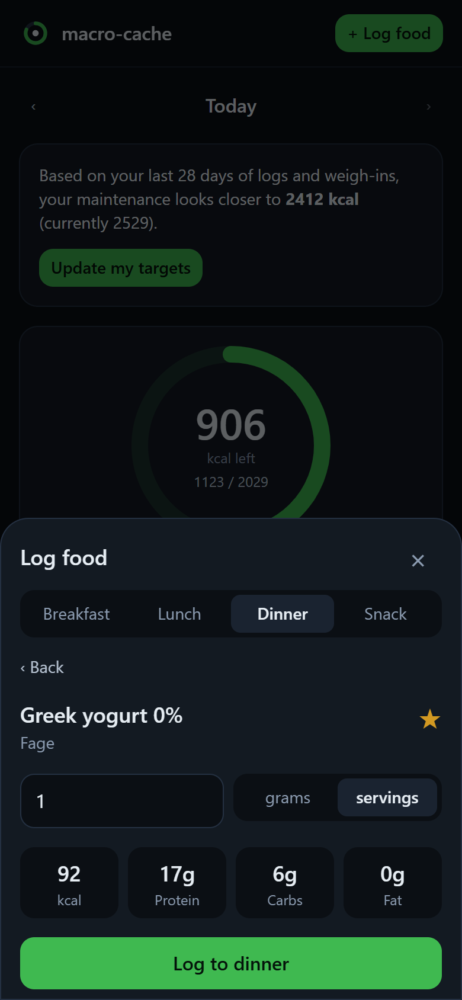
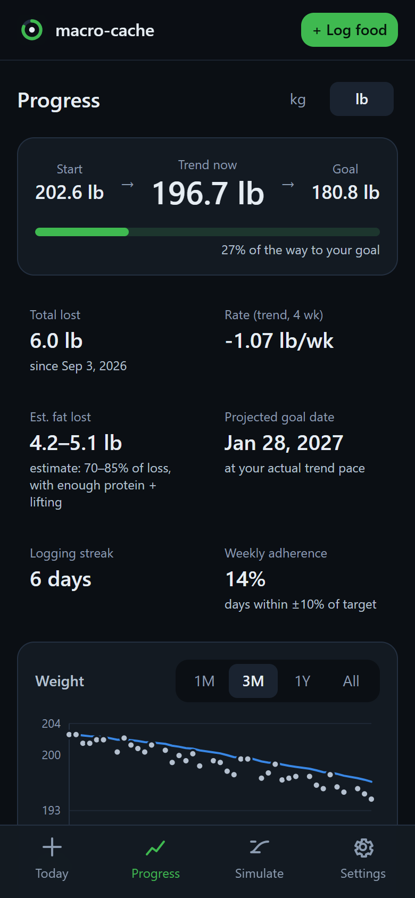
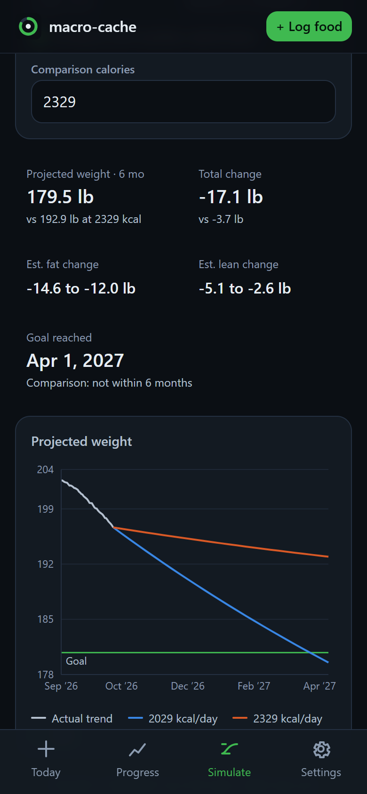

# macro-cache

**A free, open-source macro tracker that runs on the Claude plan you already have.**
No API keys, no subscription, no paid AI. Your data lives on your own free Cloudflare instance.

[](https://deploy.workers.cloudflare.com/?url=https://github.com/Shiva-Sai-Krishna-0408/macro-cache)
[](https://github.com/Shiva-Sai-Krishna-0408/macro-cache/actions/workflows/ci.yml)
[](LICENSE)

| Today | Log without AI | Progress | Simulator |
|---|---|---|---|
|  |  |  |  |

## How it works

| Piece | Role |
|---|---|
| **Claude** (web, desktop, iOS, Android) | **The brain.** Reads label photos, searches restaurant nutrition, estimates plates, and reasons about your day, all on your own Claude plan. |
| **Remote MCP server** (Cloudflare Worker + D1) | **The memory.** Stores foods, recipes, meal-prep containers, restaurant orders, logs, weigh-ins and targets, and exposes them to Claude as tools. |
| **PWA dashboard** (same Worker) | **The eyes.** Progress, projections, and fast no-AI logging (barcode, search, templates) for when you hit Claude's usage limits. |

Ask Claude *"log the chipotle bowl I had yesterday"* or *"what should I eat for dinner to hit my protein?"* and it looks up what's already saved, previews the write, and saves after you confirm.

### Features

- **Claude-native logging.** Label photos become saved foods. Meal prep becomes recipes with cooked-weight math and containers that count down portions. Restaurant orders are saved for reuse. Multi-item meals are logged in one step.
- **Science-based targets.** Mifflin-St Jeor BMR × activity, pace presets capped at ~1% body weight per week, protein 1.6 g/kg, fat ≥ 0.6 g/kg, carbs as the remainder.
- **Safety built in.** Targets are never set or suggested below max(BMR, 1200 ♀ / 1500 ♂). Under-18 profiles get maintenance only. Projections flag BMI < 18.5.
- **Adaptive TDEE.** After 14+ days of logs and weigh-ins, your real maintenance is estimated from intake and trend weight, blended with the formula, and offered as an update.
- **Progress hub.** Trend weight, % of goal, weekly rate, estimated fat lost (a range, or measured from body-fat entries), streaks, adherence, and a projected goal date from your actual pace.
- **Projection simulator.** 1–24 months, week-by-week with TDEE recomputed as weight changes, a "days per week on target" setting, and side-by-side comparison of two calorie levels.
- **Logging without AI.** Barcode scanning (Open Food Facts), **Snap label** (photograph a nutrition panel; on-device OCR with Tesseract.js prefills the form for you to check), fuzzy search, recents, favorites, templates, meal-prep one-tap, repeat yesterday, quick add.
- **Recipes page.** Every saved recipe with search: ingredients with raw weights, macros per 100 g cooked and per portion, meal-prep batch history, editable steps/notes (Claude can save these too), and one-tap "Log a portion".
- **Write safety.** Every write supports `dry_run`, passes server-side plausibility checks, is audit-logged, and can be reverted with `undo_last`. See [SECURITY.md](SECURITY.md).
- **Your data.** JSON export/import and CSV export.

## Cost: $0

- **Cloudflare free tier:** Workers, D1 and KV. A single person's usage is a tiny fraction of the free limits.
- **Your existing Claude plan:** custom connectors work on Free, Pro, Max, Team and Enterprise (the Free plan allows one custom connector). AI usage counts toward your Claude plan's normal usage limits. When you hit them, the dashboard still works.

## Setup (about 10 minutes)

You'll need a free [Cloudflare account](https://dash.cloudflare.com/sign-up) and a GitHub account.

### 1. Create a GitHub OAuth app (for sign-in)

1. Find your workers.dev subdomain: Cloudflare dashboard → **Workers & Pages** → it's shown as `<your-subdomain>.workers.dev`.
2. Go to [GitHub → Settings → Developer settings → OAuth Apps → New OAuth App](https://github.com/settings/applications/new):
   - **Homepage URL:** `https://macro-cache.<your-subdomain>.workers.dev`
   - **Authorization callback URL:** `https://macro-cache.<your-subdomain>.workers.dev/callback`
3. Create it, then **Generate a new client secret**. Keep the Client ID and secret handy.

### 2. Deploy

**One click:** press **Deploy to Cloudflare** above. Cloudflare copies this repo to your GitHub, creates the D1 database and KV namespace, builds the app, and runs the database migrations. When it asks, fill in:

| Setting | Value |
|---|---|
| `ALLOWED_GITHUB_USER` | your GitHub username, the only account allowed in |
| `GITHUB_CLIENT_ID` / `GITHUB_CLIENT_SECRET` | from step 1 |
| `COOKIE_ENCRYPTION_KEY` | any long random string, e.g. the output of `openssl rand -hex 32` |

<details>
<summary>Or deploy from the command line</summary>

```bash
git clone https://github.com/<you>/macro-cache && cd macro-cache
npm ci
npx wrangler login
npm run deploy                       # builds, deploys (creates D1 + KV), applies migrations
npx wrangler secret put GITHUB_CLIENT_ID
npx wrangler secret put GITHUB_CLIENT_SECRET
npx wrangler secret put COOKIE_ENCRYPTION_KEY
npx wrangler secret put ALLOWED_GITHUB_USER   # your GitHub username
```

**Deploy from GitHub Actions:** add the repository secrets `CLOUDFLARE_API_TOKEN` (template: *Edit Cloudflare Workers*, plus D1 edit permission) and `CLOUDFLARE_ACCOUNT_ID`, plus the repository variable `DEPLOY_ENABLED=true`. Every push to `main` then tests and deploys. (Secrets set with `wrangler secret put` persist across deploys.)
</details>

If your Worker URL differs from what you guessed in step 1, update the OAuth app's URLs to match.

### 3. Open the dashboard

Visit `https://macro-cache.<your-subdomain>.workers.dev`, sign in with GitHub, and complete the short onboarding: height, weight, age, sex, activity, goal and pace. It shows your maintenance calories, daily target and projected goal date.

### 4. Connect Claude

**Web or desktop** ([claude.ai](https://claude.ai)):
1. **Customize → Connectors → Add custom connector** (Team/Enterprise: an Owner adds it under *Organization settings → Connectors*).
2. Name: `macro-cache`. URL: `https://macro-cache.<your-subdomain>.workers.dev/mcp` (the dashboard's Settings page has a copy button).
3. If you're asked about the OAuth client, choose **Use Claude's published identity** (recommended) or **Register automatically**. Both work.
4. Click **Add**, then **Connect**. Approve the consent screen and sign in with GitHub.

**Phone (iOS / Android):** connectors belong to your Claude account, so once you've added macro-cache on the web it's available in the mobile app too. Open a chat, tap **+** → **Connectors**, and turn **macro-cache** on. (Adding custom connectors directly from the mobile app is in beta. Adding on the web is the reliable path.)

### 5. (Optional) Create a Claude Project

The connector already sends Claude its working rules automatically: look things up before asking, preview writes, handle meal prep and eating out, show neutral tradeoff cards, and treat web pages as untrusted. So any chat with macro-cache turned on behaves this way. For the longer wording, and to keep nutrition chats together, create a Project (e.g. "Nutrition") and paste in [PROJECT_INSTRUCTIONS.md](PROJECT_INSTRUCTIONS.md).

### 6. Install the dashboard on your home screen

- **iPhone / iPad (Safari):** open the dashboard → **Share** → **Add to Home Screen**.
- **Android (Chrome):** open the dashboard → **⋮** menu → **Install app** (or **Add to Home screen**).

It opens full screen and works as a fast logger even when Claude is out of messages.

## How it compares

Honestly: the commercial apps are more polished, and they have large verified food databases and native apps. macro-cache is free, private, self-hosted, and built around Claude.

| | **macro-cache** | MacroFactor | Cronometer | Cal AI |
|---|---|---|---|---|
| Price | **Free** (your Claude plan + Cloudflare free tier) | Paid subscription | Free tier + paid Gold | Paid subscription |
| Where your data lives | **Your own Cloudflare account** | Vendor cloud | Vendor cloud | Vendor cloud |
| AI logging (photos, menus) | Claude, on your plan | Some AI features | Limited | Core feature |
| Adaptive TDEE | ✅ | ✅ (best in class) | — | — |
| Food database | Your own cache + Open Food Facts | Large, curated | Large, verified, micronutrients | AI-estimated |
| Barcode scanning | ✅ (Open Food Facts) | ✅ | ✅ | ✅ |
| Meal prep / recipe yield math | ✅ cooked-weight + containers | ✅ recipes | ✅ recipes | — |
| Native apps & polish | PWA, early-stage | ✅ | ✅ | ✅ |
| Open source | ✅ MIT | — | — | — |

## Development

```bash
npm ci
npm test                 # Vitest: core engine, MCP tools end to end, security
npm run typecheck
cp .dev.vars.example .dev.vars   # fill in
npm run db:migrate:local
npm run build && npx wrangler dev --port 8788
node scripts/e2e-oauth.ts http://localhost:8788 <COOKIE_ENCRYPTION_KEY> <ALLOWED_GITHUB_USER>   # full OAuth → MCP check
```

For local GitHub sign-in, create a second OAuth app with the callback `http://localhost:8788/callback`.

| Path | What |
|---|---|
| `packages/core` | Pure, unit-tested engine shared by server and dashboard: targets, safety, trend, adaptive TDEE, projection, validation, suggestions |
| `apps/worker` | Cloudflare Worker: OAuth (GitHub), MCP server (official TypeScript SDK, streamable HTTP), dashboard API, Drizzle + D1 |
| `apps/dashboard` | Vite + React + Tailwind + Recharts PWA |
| `migrations` | D1 migrations (generated by `npm run db:generate`) |

## Contributing

Contributions are welcome. See [CONTRIBUTING.md](CONTRIBUTING.md). If a product is missing when you scan it, please [add it to Open Food Facts](https://world.openfoodfacts.org/contribute) so everyone benefits.

## Security

Restaurant pages and label photos are untrusted input, and the server is designed so that injected instructions cannot bulk-delete logs, push targets below the safety floor, or store absurd values. Read [SECURITY.md](SECURITY.md) for the threat model.

## Not medical advice

macro-cache provides estimates for general wellness and is not a medical device. Energy needs vary, and projections are approximations. If you are under 18, pregnant or breastfeeding, or have a medical condition or a history of disordered eating, talk to a doctor or registered dietitian before changing how you eat.

## License

[MIT](LICENSE)
